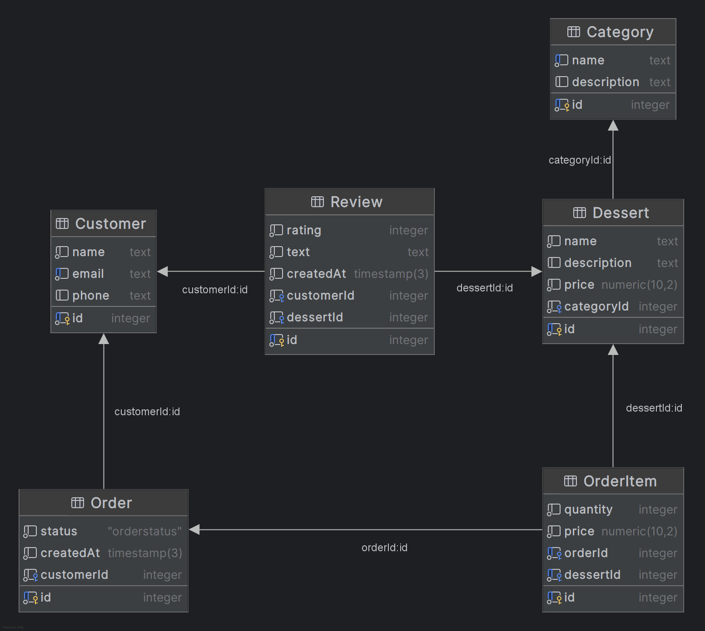

# Dessert Boutique Backend

Backend для сайта кондитерской **Dessert Boutique**

## Автор

Бородина Ирина

## Технологии

- HTML
- CSS
- JavaScript
- Node.js 22
- NestJS
- TypeScript
- Handlebars (`hbs`)
- PostgreSQL
- Prisma ORM

## Шаблонизация

Для серверного рендеринга страниц используется шаблонизатор Handlebars

## База данных

В качестве СУБД взят PostgreSQL, размещённый в облачном сервисе Aiven
Для работы приложения с базой данных была выбрана и использована Prisma ORM

## Доменная область

Предметная область приложения - работа кондитерской **Dessert Boutique**
В доменной модели выделены 6 связанных сущностей: клиент, десерт, категоря десерта, заказ, позиция заказа и отзывы

### Customer

Клиент кондитерской

Поля:

- `id` — идентификатор клиента
- `name` — имя
- `email` — электронная почта
- `phone` — номер телефона

Клиент может иметь несколько заказов и оставлять несколько отзывов

### Category

Категория десертов

Основные поля:

- `id` — идентификатор категории
- `name` — название категории
- `description` — описание категории

Одна категория может содержать несколько десертов

### Dessert

Десерт из каталога кондитерской

Основные поля:

- `id` — идентификатор
- `name` — название
- `description` — описание
- `price` — цена
- `categoryId` — идентификатор категории

Каждый десерт относится к одной категории и может присутствовать в нескольких заказах и отзывах

### Order

Заказ клиента

Основные поля:

- `id` — идентификатор заказа
- `status` — статус заказа
- `createdAt` — дата и время создания
- `customerId` — идентификатор клиента

Для статуса заказа используется перечисление:

- `NEW`
- `CONFIRMED`
- `IN_PROGRESS`
- `READY`
- `COMPLETED`
- `CANCELLED`

Один клиент может иметь несколько заказов

### OrderItem

Позиция внутри заказа

Основные поля:

- `id` — идентификатор
- `quantity` — количество
- `price` — цена десерта на момент оформления заказа
- `orderId` — идентификатор заказа
- `dessertId` — идентификатор десерта

Сущность связывает заказ с выбранными десертами

### Review

Отзыв клиента о десерте

Основные поля:

- `id` — идентификатор
- `rating` — оценка
- `text` — текст отзыва
- `createdAt` — дата создания
- `customerId` — идентификатор клиента
- `dessertId` — идентификатор десерта

Один клиент может оставить несколько отзывов, а один десерт может иметь несколько отзывов

## Связи между сущностями

- `Customer` 1:N `Order`
- `Customer` 1:N `Review`
- `Category` 1:N `Dessert`
- `Order` 1:N `OrderItem`
- `Dessert` 1:N `OrderItem`
- `Dessert` 1:N `Review`

## ER-диаграмма

## Ссылка на развёрнутое приложение

https://m3310-borodina-back.onrender.com